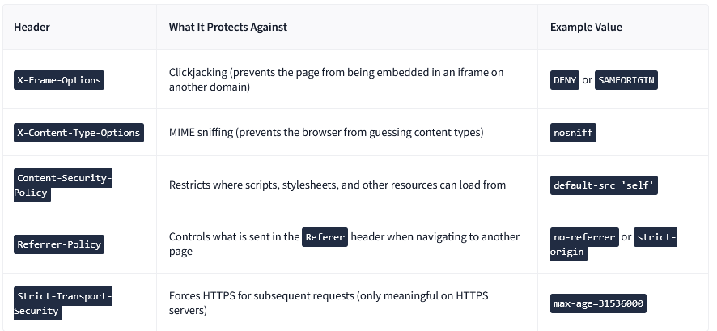
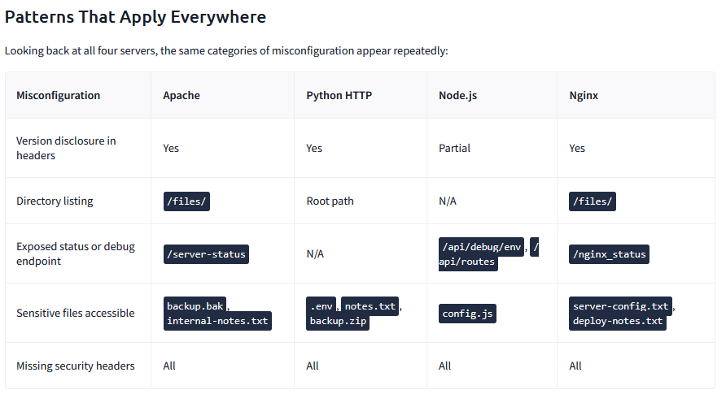

# Webserver und Fehlkonfigurationen

## Identifizieren von Webservern
```bash
curl -sI http://TargetIP
```
The Server-header tells the kind of Server if not supressed. Except node.js, which does not communicate the server-header. On the other hand provide typical nodejs server the X-Powered-By: Express Header. 

Also in the browser Development tools in the networktab the headers a visible.


### Python Http Server
```bash
# This command serves the current working directory over HTTP on port 8000
python3 -m http.server 8000
```
This python webserver serves everything in the working directory, with no exception. When there is no index.html file, python creates are directory listing.
To access from the webserver:
```bash
curl -s http://targetIP:port/.env
```
To download from the webserver:
```bash
curl -s http://targetIP:port/backup.zip -o backup.zip
```

### Apache2

To detect de Version:

```bash
curl -SI http://10.81.131.23:80 | grep -i server
```

The directory can be seeh if configured trough:
```bash
curl -s http://10.80.176.242/files/
```
The Endpoint-status:
```bash
http://10.80.176.242:80/server-status
```
To find files, which have no link in the pages or directory, gobuster con find them.
```bash
gobuster dir -u http://TARGET_IP:80 -w /usr/share/wordlists/SecLists/Discovery/Web-Content/common.txt -x bak,txt,html -t 20
```
If files like  .htpasswd  and .bak are found, they require further notice, because .htpasswd store access information like usernames and hashes of passwords for the http authentication.


### Node.js

Application Version:
```bash
curl -s http://MACHINE_IP:Port
```
Express has a build in error handler, which should be supressed in production. But in development it passes teh responces through. It is common to have custom error handler. If there is a 500 internal server error, it shold be investigated further.
```bash
curl -s http://MACHINE_IP:3000/api/users | python3 -m json.tool
#Example:
{
    "error": "connect ECONNREFUSED 127.0.0.1:5432",
    "stack": "Error: connect ECONNREFUSED 127.0.0.1:5432\n    at /opt/nodeapp/app.js:16:15\n    at Layer.handle [as handle_request] (/opt/nodeapp/node_modules/express/lib/router/layer.js:95:5)\n    at next (/opt/nodeapp/node_modules/express/lib/router/route.js:149:13)\n    at Route.dispatch (/opt/nodeapp/node_modules/express/lib/router/route.js:119:3)\n    at Layer.handle [as handle_request] (/opt/nodeapp/node_modules/express/lib/router/layer.js:95:5)\n    at /opt/nodeapp/node_modules/express/lib/router/index.js:284:15\n    at Function.process_params (/opt/nodeapp/node_modules/express/lib/router/index.js:346:12)\n    at next (/opt/nodeapp/node_modules/express/lib/router/index.js:280:10)\n    at expressInit (/opt/nodeapp/node_modules/express/lib/middleware/init.js:40:5)\n    at Layer.handle [as handle_request] (/opt/nodeapp/node_modules/express/lib/router/layer.js:95:5)",
    "query": "SELECT * FROM users"
}
```
To enumerate routes, a misconfigured Expressapplication could leak them:
```bash
curl -s http://MACHINE_IP:3000/api/routes
#Example:
[{"method":"GET","path":"/"},{"method":"GET","path":"/api/users"},{"method":"GET","path":"/api/routes"},{"method":"GET","path":"/api/debug/env"}]

```
To enumerate Environment Variables, a misconfigured Expressapplication could leak them:

```bash
curl -s http://MACHINE_IP:3000/api/debug/env
#Example:
{"NODE_ENV":"development","DB_PASSWORD":"NodeDBPass2024!","PORT":"3000","DB_HOST":"localhost:5432","APP_NAME":"company-portal"}r
```
The express framework uses the express.static() middleware to serve front-end assets like js, css and configuration files. Client-Side files could leak some API endpoints. 
```bash
curl -s http://MACHINE_IP:3000/static/config.js
#Example:
// Client-side configuration
const API_BASE = 'http://internal-api.company.local:8080';
const DEBUG = true;
const VERSION = '1.2.0';
```


### Nginx
Application Version:
```bash
curl -sI http://MACHINE_IP:Port| grep -i server
```
Servertokens handle which and how many informations are displayed in the server header. If the tokens are surpressed, you can request a nonn existing path, to see if they are completly supressed or partially.
```bash
curl -s http://MACHINE_IP:Port/nonexistent-path
```
Nginx onlyy lists directory if the autoindex flag is configured.
```bash
curl -s http://MACHINE_IP:Port/files/
<html>
<head><title>Index of /files/</title></head>
<body>
<h1>Index of /files/</h1><hr><pre><a href="../">../</a>
<a href="deploy-notes.txt">deploy-notes.txt</a>                                   03-Apr-2026 18:23                 148
<a href="old-backup.tar.gz">old-backup.tar.gz</a>                                  03-Apr-2026 18:23                 236
<a href="server-config.txt">server-config.txt</a>                                  03-Apr-2026 18:23                 135
</pre><hr></body>
</html>
```
The nginx-status endpoints could expose, if wrongly configured, the monitoring network or other helat endpoints.
```bash
curl -s http://MACHINE_IP:Port/nginx_status
Active connections: 1 
server accepts handled requests
 15 15 15 
Reading: 0 Writing: 1 Waiting: 0 
```

## Common Misconfigurations 
Security Headers instruct the browser how to handle the page content. They protect against client-side attacks, but on the default servers, they are not configured.
The most common one:

To extract the security headers:

```bash
for port in 80 8000 3000 8080; do echo "=== Port $port ==="; curl -sI http://10.80.176.242:$port/ | grep -iE "x-frame-options|x-content-type|content-security-policy|strict-transport|referrer-policy" || echo "(no security headers found)"; done
=== Port 80 ===
(no security headers found)
=== Port 8000 ===
(no security headers found)
=== Port 3000 ===
(no security headers found)
=== Port 8080 ===
(no security headers found)
```



## IIS Fingerprinting 


## IIS Tilde Enumeration


## ASPX Web Shells


## IIS Misconfigurations


## Automation

The web-page-scanning can be automatd by using nikto:
```bash
nikto -h http://10.80.176.242:80 -nointeractive
- Nikto v2.1.5
---------------------------------------------------------------------------
+ Target IP:          10.80.176.242
+ Target Hostname:    10.80.176.242
+ Target Port:        80
+ Start Time:         2026-04-11 09:16:09 (GMT1)
---------------------------------------------------------------------------
+ Server: Apache/2.4.58 (Ubuntu)
+ Server leaks inodes via ETags, header found with file /, fields: 0x29af 0x64e9243796aa2 
+ The anti-clickjacking X-Frame-Options header is not present.
+ No CGI Directories found (use '-C all' to force check all possible dirs)
+ Allowed HTTP Methods: HEAD, GET, POST, OPTIONS 
+ OSVDB-561: /server-status: This reveals Apache information. Comment out appropriate line in httpd.conf or restrict access to allowed hosts.
+ OSVDB-3268: /files/: Directory indexing found.
+ OSVDB-3092: /files/: This might be interesting...
+ 6544 items checked: 0 error(s) and 6 item(s) reported on remote host
+ End Time:           2026-04-11 09:16:18 (GMT1) (9 seconds)
---------------------------------------------------------------------------
+ 1 host(s) tested
```


```bash

```